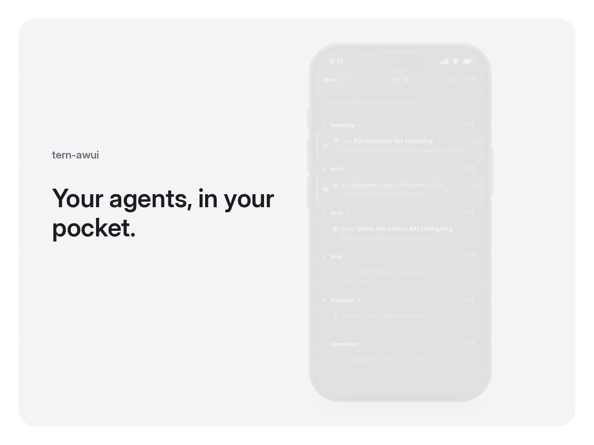

# tern-awui (another web UI for Tern)

A web app for following and steering the [omp](https://github.com/can1357/oh-my-pi) agents running in [Tern](https://stencil.so/tern), from a phone or another browser.

I built it for how I work. Tern stays open on the desktop with its panes, tern-awui sits next to it in a browser tab, and the same app is installed on my Android phone as a PWA. When I step away, I can still see which agent finished, which one is waiting for an answer, and reply. It's a companion to Tern, not a replacement: a project-based, focused view of the sessions.



The same task can move between screens: started in Tern, finished in a desktop browser, answered on the phone and sent from Tern again.


<details>
<summary>Screenshots</summary>

| Phone: sessions | Phone: a session | Phone: a question |
|---|---|---|
|  |  |  |


</details>

It has no login of its own. You reach it over a private network you control, such as Tailscale (see [Security](#security)).

## Features

- **Every omp session at a glance.** Working, waiting for you, or idle, with the time in that status, the session's title, icon and tag, and the last prompt or omp's own recap.
- **Grouped by project.** Sessions are grouped by git repository (or folder), the most recently active first. Projects fold away, and sessions untouched for a day can be hidden with one tap.
- **The conversation, not the terminal.** omp sessions show as a chat: Markdown, tool runs, todo lists, charts, Mermaid and SVG figures, images, and the reply streaming in as omp writes it. Code blocks and quotes each have a Copy button. While the agent works, omp's working row shows what it is doing right now.
- **Stretchtext replies.** With [omp-stretch](https://github.com/materemias/omp-stretch), replies arrive as their gist and a tap grows the detail in place, in sync with the Tern pane. Tap ✦ on an open stretch to ask the model for more.
- **Two-way control.** Send prompts, steer a running turn or queue a follow-up, stop the agent, answer `ask` questions with a tap, attach photos or paste a copied image, and use omp's `/command`, `/skill:` and `@file` completions.
- **The draft is shared.** Text typed on the phone appears in the Tern pane's prompt and the other way round, so you can start on one and finish on the other.
- **Talk to omp.** The microphone button starts omp's live voice mode with the phone as its microphone and speaker: say what you want, the voice model hands coding work to the session as ordinary turns, and reads back the result. The screen stays on while you talk. Needs an omp newer than 18.13.3 and an OpenAI Codex sign-in in omp.
- **Session controls.** Switch model, effort or Ctrl+P role, watch the context gauge, rewind or copy, ask a side question with `/btw`, and read running subagents' conversations.
- **Swipe between sessions.** Swipe left or right on an open session to reach the next or previous omp session in the list's order, or between a session's subagents. Turn the finger up or down mid-swipe to pick any session from a wheel, and lift to open it. Back still leads to the list. On a keyboard, Alt+← and Alt+→ switch at once.
- **Notifications.** Optional push notifications when a session finishes or needs you, and an unread count on the app icon. Notifications dismiss when you open the session or start another turn, including on desktop, while the mobile app is active. Cleanup preserves newly arrived unread notifications. If the app is closed or suspended, dismissal waits until it resumes.
- **Shells and files too.** Plain terminals show their screen with a key bar (Esc, ^C, arrows, Tab), and Tern notes and opened files are readable.

## Works with Tern

- **Close** a session from the web, and its pane closes in Tern.
- **+ omp** opens a new omp tab in Tern in any project folder and jumps to it.
- **The monitor button** in a session's header focuses that pane in the Tern window on the desktop.
- Drafts, model changes, answers and rewinds happen in the real omp session in its Tern pane, so the desktop and the web never disagree.

## Requirements

- [Bun](https://bun.sh) 1.4 or newer
- Tern and omp, with `tern` and `omp` on `PATH`
- [Tailscale](https://tailscale.com), logged in, with MagicDNS and HTTPS certificates enabled. The installer needs it; without it, see [Without Tailscale](#without-tailscale).
- git (optional, for grouping by repository and showing branches)

I use it daily on Linux with Chrome on Android. macOS is tested. iPhone (Safari) and Windows should work but are untested, and reports are welcome.

## Install

### With a coding agent

Paste this prompt into an agent (omp, Claude Code, Codex, …) running on the desktop where Tern runs:

```text
Install tern-awui (https://github.com/materemias/tern-awui) on this machine.

1. Read its README, especially Requirements, Install and Security.
2. Check every requirement and tell me what is missing instead of working around it.
   The installer needs Tailscale logged in with MagicDNS and HTTPS certificates enabled.
3. Clone it to ~/code/tern-awui (ask me if I want a different place), then run `bun install`.
4. Run `bun install.ts --dry-run`, summarize what it will write and run, and wait for my OK.
5. Run `bun install.ts` and give me the address it prints.

Never use Tailscale Funnel, port forwarding or a public tunnel.
At the end, remind me to run /restart in omp sessions that were already running.
```

### By hand

```bash
git clone https://github.com/materemias/tern-awui.git
cd tern-awui
bun install
bun install.ts            # add --dry-run to see every step first
```

The installer builds the web app, links the omp extension, starts a user service (systemd, launchd or Task Scheduler), publishes it on your tailnet with `tailscale serve`, and prints the address, e.g. `https://my-desktop.tailnet-name.ts.net:4380/`. On Linux the service process is named `tern-awui`, not `bun`, so scheduler rules for bun (such as ananicy-cpp's) don't push it to idle priority.

Open that address on each device while signed in to Tailscale. To install it as an app, use Chrome's ⋮ → *Add to Home screen* on Android or Safari's Share → *Add to Home Screen* on iPhone. The installer lets in only your own Tailscale login, so there is nothing to pair.

omp loads extensions only when it starts, so run `/restart` in sessions that were already running. The web app marks outdated sessions and offers a **Reload** button that does it for you.

### Without Tailscale

```bash
bun install && bun run build
bun server.ts                    # http://127.0.0.1:4380/, TERN_AWUI_PORT changes the port
```

Link `omp-extension/tern-mobile.ts` into `~/.omp/agent/extensions/` yourself. Reaching the server from other devices is up to you, so read [Security](#security) first.

### Updating and removing

```bash
git pull && bun install.ts      # rebuild, update and restart the service
bun install.ts --uninstall      # remove the service, the extension and the tailnet entry
```

## Security

**tern-awui has no authentication.** Anyone who can send it a request controls your terminals: they can type commands, read your agents' conversations and open files.

It listens on `127.0.0.1` only. What you put in front of that port decides who reaches it:

- **Loopback only** (no proxy): only programs on this machine.
- **Tailscale Serve** (what the installer sets up): only devices on your tailnet. `TERN_AWUI_ALLOW` (set by the installer) narrows that to your own Tailscale login.
- **Another authenticating proxy** (e.g. Cloudflare Access, an SSH tunnel): it must refuse everyone but you. Add the name it serves under to `TERN_AWUI_HOSTS`.

**Never expose it publicly:** no port forwarding, no Tailscale Funnel, no tunnel without its own login. It also assumes a single-user machine, since every local account can reach `127.0.0.1`.

What it does protect against, and why, is in [how it works](docs/architecture.md#security).

## Limits

- It is not a terminal emulator. Full-screen programs like vim or htop are only usable through the screen view and the key bar.
- Sessions without the extension show as plain terminals.
- The extension uses some omp internals; a new omp version can turn individual features off until the extension catches up.
- Voice calls end when the session screen closes. Phones may also cut a call when the screen locks or the app goes to the background (iOS Safari does), and the call stays on the phone that started it.
- Swiping between sessions follows the list's hidden-old and folded projects, but not a filter typed in the desktop sidebar. A swipe that starts on something that scrolls sideways (a wide code block or table), or within 24 px of the screen edge, scrolls or goes back instead.

## More

- [How it works](docs/architecture.md): every feature in detail, the extension's protocol, configuration, build and tests.
- [CHANGELOG](CHANGELOG.md)
- [CodexBar AgentView](https://github.com/materemias/codexbar-agentview): the desktop-side counterpart, with usage and agent counts in Tern's status line.
- License: [MIT](LICENSE). The bundled Nerd Font symbols are SIL OFL 1.1 ([license](assets/LICENSE-nerd-fonts-symbols)).
