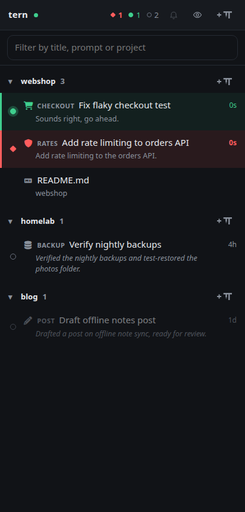
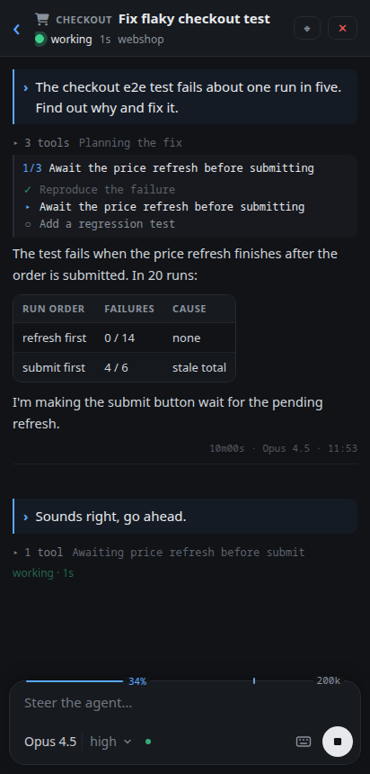
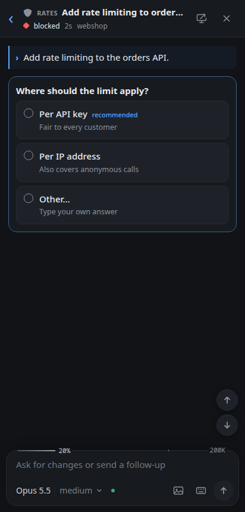
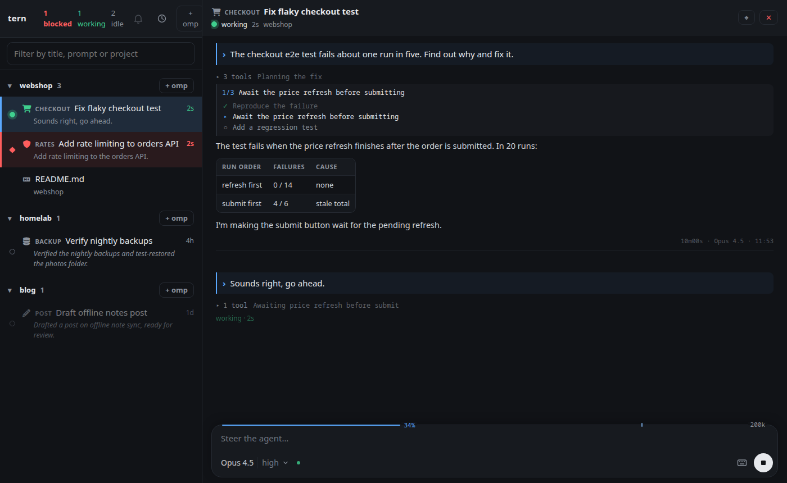

# tern-awui

Keep your omp sessions moving from your phone. tern-awui is a small, fast web app for the [omp](https://github.com/can1357/oh-my-pi) agents running in [Tern](https://stencil.so/tern) on your desktop: see which one needs you, answer or steer it, and put the phone away.

**[Try the demo](https://materemias.github.io/tern-awui/)**: the real app in your browser with sample sessions, every feature included, from tool approvals and the Waiting popup to a scripted voice call. It opens on a session waiting for an approval and needs no Tern or omp; nothing leaves the browser. The notification bell switches on, but the demo sends no notifications.

## Why not Tern's mobile app?

Tern's own mobile app follows Tern's layout, tab by tab. tern-awui does one job, looking after your sessions on the go, and is built around it:

- **Fast.** The whole app is one script of about 240 KB that opens straight onto your sessions. Updates arrive over one event stream, and heavy parts such as Mermaid load only when a reply needs them.
- **Projects, not tabs.** Sessions are grouped by git repository, newest activity first, and a red row marks each one that waits on you. On a phone that answers "what needs me?" in one glance, wherever the session's tab is.
- **Deep integration with omp's extensions.** [omp-stretch](https://github.com/materemias/omp-stretch) replies open stretch by stretch, in sync with the Tern pane. [CodexBar AgentView](https://github.com/materemias/codexbar-agentview)'s set-aside sessions show in a Waiting popup with **Done** and **Snooze**. Tool approvals and `ask` forms are answered with a tap, and tool runs fold to one line each, as with [omp-compact](https://github.com/arksdev/omp-compact). See [Works best with](#works-best-with).

I built it for how I work. Tern stays open on the desktop, tern-awui sits next to it in a browser tab, and the same app is installed on my Android phone as a PWA. When I step away, I still see which agent finished and which one waits on me, and I can reply.


tern-awui runs no agents of its own. Every session it shows is an omp running in a Tern pane on your desktop, so the desktop and the phone work on the same sessions together:

- **Whatever is open in Tern continues on the phone.** Read the reply, answer its question, allow or deny a tool call it waits on, steer the turn or send the next prompt, and the Tern pane shows it too.
- **A session started on the phone opens a Tern tab on the desktop.** **+ omp** picks a project folder and starts omp there in a new tab, waiting for you when you sit back down.
- **Both screens drive the same omp.** Drafts, answers, model changes and rewinds go to the omp in its Tern pane, so the two never disagree.


The same task can move between screens: started in Tern, finished in a desktop browser, answered on the phone and sent from Tern again.


<details>
<summary>Screenshots</summary>

| Phone: sessions | Phone: a session | Phone: a question |
|---|---|---|
|  |  |  |



</details>

It has no login of its own. You reach it over a private network you control, such as Tailscale (see [Security](#security)).

## Features

- **Every omp session at a glance.** Working, waiting for you, or idle, with the time in that status and the session's title, icon and tag. A busy row says what it is doing or the question it asks; press and hold a row (or rest the mouse on it) for omp's recap or the last prompt.
- **Grouped by project.** Sessions are grouped by git repository (or folder), the most recently active first. Projects fold away, and sessions untouched for a day can be hidden with one tap.
- **Tern sessions.** With more than one Tern session in the window, chips under the header (`All · Default · weekend`, the one the desktop shows marked with a dot) narrow the list to one session's tabs; parked panes that wait on you stay. The pick is kept on each device, and **+ omp**, Closed's resume and Parked's unpark open in a new tab of the picked session.
- **The conversation, not the terminal.** omp sessions show as a chat: Markdown, tool runs, todo lists, charts, Mermaid and SVG figures, images, and the reply streaming in as omp writes it. Code blocks and quotes each have a Copy button. While the agent works, omp's working row shows what it is doing right now, with the todo list's progress and current task; a tap there jumps to the list. A reply that missed the prompt cache is marked as in Tern, with the tokens it sent again. Scrolled up, a round button takes you back to the latest output, with a dot when something new arrived; hold it to step back one prompt instead.
- **One answer per turn.** Each prompt is followed by one line, such as `Worked 7m12s · 38 tools · 3 failed`, and then the final reply. When the advisor raised a note after the answer, the answer, the note and the agent's reply to it all stay in view. A tap on that line shows the tool runs and interim messages behind it. A test run, typecheck or search shows its result next to it, like `412 passed · 3 failed` or `no type errors`, so you see whether the suite passed without opening anything. The running turn stays open, and an unanswered question is always in view. Long prompts fold to six lines. While you read a long reply, its prompt stays pinned at the top as one line, and a tap on it takes you back to the prompt.
- **What each turn changed.** A turn that edited files ends with a card, `3 changed files +12 −4`, listing each file with its folder and line counts. It folds when there are more than three.
- **Stretchtext replies.** With [omp-stretch](https://github.com/materemias/omp-stretch), replies arrive as their gist and a tap grows the detail in place, in sync with the Tern pane. Tap ✦ on an open stretch to ask the model for more.
- **Two-way control.** Send prompts, steer a running turn or queue a follow-up, stop the agent, fill in `ask` forms on the phone (a single choice sends with one tap; images pasted into a note in Tern show on the answered card), deny a tool call with a reason the agent reads next, attach photos or paste a copied image, and use omp's `/command`, `/skill:` and `@file` completions. Once omp takes your answer to an approval or form, a short line above the composer confirms it.
- **Share to it.** On Android, share a screenshot, text or link from any app to the installed app, tap the session it's for, and it waits in that composer as a draft. Long-press the app icon for **Waiting**. In the demo, add `?share=demo` to the address.
- **The draft is shared.** Text typed on the phone appears in the Tern pane's prompt and the other way round, so you can start on one and finish on the other.
- **Talk to omp.** The microphone button starts omp's live voice mode with the phone as its microphone and speaker: say what you want, the voice model hands coding work to the session as ordinary turns, and reads back the result. The screen stays on while you talk, and the moon button turns it black for the pocket (cycling, walking) with the microphone still on; hold a finger on it for a second to bring the call back. Needs an omp newer than 18.13.3 and an OpenAI Codex sign-in in omp.
- **Session controls.** Switch model, effort or Ctrl+P role, watch the context gauge, rewind or copy, ask a side question with `/btw`, and read subagents' conversations, finished ones too, from **Subagents (N)** under the chat.
- **Swipe between sessions.** Swipe left or right on an open session to reach the next or previous omp session in the list's order, or between a session's subagents. Turn the finger up or down mid-swipe to pick any session from a wheel, and lift to open it. Back still leads to the list. On a keyboard, Alt+← and Alt+→ switch at once.
- **Usage limits.** When a turn stops on a provider's usage or rate limit, a banner above the composer says when the limit resets. **Continue when it resets** has the server send `Continue from where you stopped.` a minute after the reset, with the phone closed; every phone shows the time and a Cancel. **Continue now** sends it at once.
- **Notifications.** Optional push notifications when a session finishes or needs you, and an unread count on the app icon. Notifications dismiss when you open the session or start another turn, including on desktop, while the mobile app is active. Cleanup preserves newly arrived unread notifications. If the app is closed or suspended, dismissal waits until it resumes.
- **Waiting.** With [CodexBar AgentView](https://github.com/materemias/codexbar-agentview) on the desktop, a strip under the list's header (a pill beside the Tern session chips) counts the sessions you set aside, red when some are on you. A tap opens them over the list, grouped On me, Machine watching, Waiting on something, When I have time, one line each on where the session stands; **Done** on a row on you clears it in one tap. Tap a row for the session in full: where it stands, your note and omp's suggestion, what else it waits on, its PRs, what happened and the recap, with **Open** or **Resume**, **Snooze 1d** and **Done** at the bottom. Notes and a manual wait (your own words, marked done by you) edit in place. An open session that is set aside shows its wait above the composer, as Tern's pane does, and a tap opens it in Waiting. A session that lands on you sends a notification. On the minimized desktop sidebar an hourglass with the on-you count opens the same popup.
- **Shells and files too.** Plain terminals show their screen with a key bar (Esc, ^C, arrows, Tab), and Tern notes and opened files are readable, Markdown with its local images.
- **First-run guide.** A short tour on first open, on the phone and on the desktop: the list, Waiting, **+ omp** and the dock, then a session's composer, cards, voice call and header actions. **Guide** in the dock replays it.
- **The dock.** A small floating pill in the list's lower right corner, within thumb reach: **Notifications**, **Hide old** (sessions older than a day, with how many it hides), **Guide** and **About** (the version, and which [Works best with](#works-best-with) tools this desktop has installed). The header keeps what is happening (the counts), the search button and **+ omp**; on the phone the filter opens from that search button.

## Works with Tern

- **Close** a session from the web, and its pane closes in Tern.
- **Park** a session or shell from the ⋯ menu in its header (a button beside × on the desktop) to put it away in Tern, still running. It leaves the list, except while it waits on you or has news you haven't seen. The **Parked** tab of the **+ omp** sheet lists parked panes by project, and a tap brings one back into a tab of its own and opens it. Panes parked in a Tern session that has closed since can't come back into a tab: they sit apart, to open in the app or close. Files and notes can't be parked from the web: Tern stops listing them once parked.
- **+ omp** opens a new omp tab in Tern in any project folder and jumps to it.
- **Closed** in the same sheet lists the omp sessions you typed into that no Tern pane runs any more, newest first, with their title, recap and folder. Typing searches all your omp sessions on the server, plus Claude Code and Codex sessions; a tool's name (`claude`, `codex`, `omp`) shows only that tool's. A tap reopens one in a new Tern tab in its folder (`omp --resume`, `claude --resume`, `codex resume`), and × hides it from the list.
- **Show on desktop** in a session's ⋯ menu (a button on the desktop) focuses that pane in the Tern window on the desktop.
- **Updates.** When a new tern-awui release is out, Tern shows one toast. **tern-awui: Update** in Tern's palette opens a tab in the checkout with the update typed, for you to check and run with Enter; **tern-awui: What's new** opens the release notes.

## Works best with

These run on the desktop beside Tern and omp. tern-awui picks up omp-stretch and AgentView by itself, with nothing to configure on its side, and shows tools as compactly as omp-compact without it. **About** in the dock shows which of them this desktop has installed and links to each one's install steps.

- **[omp-stretch](https://github.com/materemias/omp-stretch).** omp's replies arrive as short gists, and a tap grows the detail in place. The phone shows the same stretches, opens and closes them in sync with the Tern pane, and its ✦ asks the model for more.

  ```sh
  omp plugin marketplace add materemias/omp-stretch
  omp plugin install omp-stretch@omp-stretch
  tern plugin link ~/.omp/plugins/node_modules/omp-stretch/tern-plugin
  ```

- **[CodexBar AgentView](https://github.com/materemias/codexbar-agentview).** Set a session aside in Tern with a sentence about what it waits for, and code watches the wait. The phone's **Waiting** strip counts what is back on you, and **Done**, **Snooze 1d** and notes go straight back to it.

  ```sh
  git clone https://github.com/materemias/codexbar-agentview
  cd codexbar-agentview && tern plugin link tern
  ```

- **[omp-compact](https://github.com/arksdev/omp-compact).** Folds omp's tool log in the Tern pane to one line per action. tern-awui does the same on its own: each tool run is one short line, and a finished turn folds them behind `Worked … · N tools`, so the pane and the phone read alike.

  ```sh
  omp plugin marketplace add arksdev/omp-compact
  omp plugin install omp-compact@arksdev
  ```

Restart omp after installing an omp plugin. Each project's README has the rest of its setup (omp-stretch's renderer settings, omp-compact's Extension Transcript Presenters switch).

## Requirements

- [Bun](https://bun.sh) 1.4 or newer
- Tern and omp, with `tern` and `omp` on `PATH`
- [Tailscale](https://tailscale.com), logged in, with MagicDNS and HTTPS certificates enabled. The installer needs it; without it, see [Without Tailscale](#without-tailscale).
- git (optional, for grouping by repository and showing branches)

I use it daily on Linux with Chrome on Android. macOS is tested. iPhone (Safari) and Windows should work but are untested, and reports are welcome.

## Install

### With a coding agent

Paste this prompt into an agent (omp, Claude Code, Codex, …) running on the desktop where Tern runs:

```text
Install tern-awui (https://github.com/materemias/tern-awui) on this machine.

1. Read its README, especially Requirements, Install and Security.
2. Check every requirement and tell me what is missing instead of working around it.
   The installer needs Tailscale logged in with MagicDNS and HTTPS certificates enabled.
3. Clone it to ~/code/tern-awui (ask me if I want a different place), then run `bun install`.
4. Run `bun install.ts --dry-run`, summarize what it will write and run, and wait for my OK.
5. Run `bun install.ts` and give me the address it prints.

Never use Tailscale Funnel, port forwarding or a public tunnel.
At the end, remind me to run /restart in omp sessions that were already running.
Then ask whether I also want omp-stretch, CodexBar AgentView or omp-compact
(the "Works best with" section) and install the ones I pick, following their READMEs.
```

### By hand

```bash
git clone https://github.com/materemias/tern-awui.git
cd tern-awui
bun install
bun install.ts            # add --dry-run to see every step first
```

The installer builds the web app, links the omp extension, starts a user service (systemd, launchd or Task Scheduler), publishes it on your tailnet with `tailscale serve`, and prints the address, e.g. `https://my-desktop.tailnet-name.ts.net:4380/`. On Linux the service process is named `tern-awui`, not `bun`, so scheduler rules for bun (such as ananicy-cpp's) don't push it to idle priority.

Open that address on each device while signed in to Tailscale. To install it as an app, use Chrome's ⋮ → *Add to Home screen* on Android or Safari's Share → *Add to Home Screen* on iPhone. The installer lets in only your own Tailscale login, so there is nothing to pair.

omp loads extensions only when it starts, so run `/restart` in sessions that were already running. The web app marks outdated sessions and offers a **Reload** button that does it for you.

### Without Tailscale

```bash
bun install && bun run build
bun server.ts                    # http://127.0.0.1:4380/, TERN_AWUI_PORT changes the port
```

Link `omp-extension/tern-mobile.ts` into `~/.omp/agent/extensions/` yourself. Reaching the server from other devices is up to you, so read [Security](#security) first.

### Updating and removing

```bash
git pull --ff-only && bun install && bun install.ts   # rebuild, update and restart the service
bun install.ts --uninstall                            # remove the service, the extension and the tailnet entry
```

## Security

**tern-awui has no authentication.** Anyone who can send it a request controls your terminals: they can type commands, read your agents' conversations and open files.

It listens on `127.0.0.1` only. What you put in front of that port decides who reaches it:

- **Loopback only** (no proxy): only programs on this machine.
- **Tailscale Serve** (what the installer sets up): only devices on your tailnet. `TERN_AWUI_ALLOW` (set by the installer) narrows that to your own Tailscale login.
- **Another authenticating proxy** (e.g. Cloudflare Access, an SSH tunnel): it must refuse everyone but you. Add the name it serves under to `TERN_AWUI_HOSTS`.

**Never expose it publicly:** no port forwarding, no Tailscale Funnel, no tunnel without its own login. It also assumes a single-user machine, since every local account can reach `127.0.0.1`.

What it does protect against, and why, is in [how it works](docs/architecture.md#security).

## Limits

- It is not a terminal emulator. Full-screen programs like vim or htop are only usable through the screen view and the key bar.
- Sessions without the extension show as plain terminals.
- The extension uses some omp internals; a new omp version can turn individual features off until the extension catches up.
- The Closed list knows a session is open only through the extension, so an omp running in another terminal, or one that hasn't connected yet, shows there too. If a Tern tab started with `omp` runs in the session's folder without the extension, resuming asks first. An omp typed by hand into a shell tab can't be told apart, so check before resuming it. The list skips sessions whose folder was deleted. Sessions from before this feature are found through omp's prompt history only, which misses a session whose every prompt was typed again later in another one.
- Claude Code and Codex sessions show up only in a search, only if you typed into them (their `history.jsonl`) and only while their transcript is on disk; Claude Code deletes transcripts after 30 days by default. Neither tool says whether a session is running, so a search lists running ones too; resuming one opens the Tern tab whose command names it, and asks first if a tab runs the tool in its folder. A resumed Claude Code or Codex session shows here as a plain terminal.
- Voice calls end when the session screen closes. With the screen off, Android keeps playing the voice but silences the phone's microphone until you unlock, so use the black screen instead of the power button. Phones may also cut a call when the app goes to the background (iOS Safari does), and the call stays on the phone that started it.
- Swiping between sessions follows the list's hidden-old and folded projects, but not a filter typed in the desktop sidebar or a picked Tern session. A swipe that starts on something that scrolls sideways (a wide code block or table), or within 24 px of the screen edge, scrolls or goes back instead.
- Parking needs Tern's plugins and the tern-awui plugin the installer links. When no Tern window is open, parking or unparking starts one. Unparking into a picked Tern session needs plugin 0.2.0, and telling panes from closed sessions apart 0.3.0; the installer links the plugin from the checkout, so `tern plugin reload tern-awui` loads it after a `git pull`.
- The update check needs plugin 0.4.0 and the plugin linked from a git checkout, as the installer does. It asks GitHub at most twice a day (hourly after a failed try) and compares the latest release with the checkout's `package.json`. The installer doesn't remember `--port` or `TERN_AWUI_*` settings, so add them to the typed update line if you installed with them.
- The session chips show the sessions of one Tern window, the one the server's `tern` commands reach.
- Waiting needs CodexBar AgentView, whose `codexbar_waiting.py` watches the waits and holds every rule; tern-awui only shows them and passes on taps. Without it the strip doesn't show. The service must share the desktop's `XDG_STATE_HOME`. What lands on you while the server is down sends no notification. omp's own schedules (AgentView's On a timer group) don't show.
- Answering an `ask` needs omp 18.18.3 or newer, whose `ask` is an HTML form; an older omp's questions can be answered only in the Tern pane, and an ask written as a question list needs omp 19. The phone types the answer into omp's form as keys, and omp 19 moves the form's cursor differently, so the phone needs the session's omp release from the current extension: until omp restarts on it, a form with preselected options is refused with a note to restart. Dropdowns end up as picked on the phone. Checkboxes are toggled from the values the form opened with, and in omp 19 radios and boxes are reached from the option the form opened with, so a group the desktop already changed in the same form may need a second look.
- A tool approval offers **Approve once** and **Deny**; omp's other choices (approve for the session, a folder or always) stay in the Tern pane. The phone presses omp's approve key (Ctrl+Q, its default) or Escape in the pane, so a rebound approve key breaks **Approve once**. Why omp asks (such as `Restricted folder: …`) shows only once omp has loaded the updated extension. omp's dialog has no reason field, so a Deny's reason reaches the agent as a message of its own, a steer of the running turn; it also denies any other call already waiting. It needs omp restarted on the current extension.
- The reset time comes from Codex's `retry-after-ms` in the error message, else from `omp usage --json`, else from a `reset at` date in the message, read as local time; when none names a future time, only **Continue now** is offered. A spending or credit cap gets **Continue now** only.

## More

- [How it works](docs/architecture.md): every feature in detail, the extension's protocol, configuration, build and tests.
- [CHANGELOG](CHANGELOG.md)
- [CodexBar AgentView](https://github.com/materemias/codexbar-agentview): the desktop-side counterpart, with usage and agent counts in Tern's status line.
- License: [MIT](LICENSE). The bundled Nerd Font symbols are SIL OFL 1.1 ([license](assets/LICENSE-nerd-fonts-symbols)).
