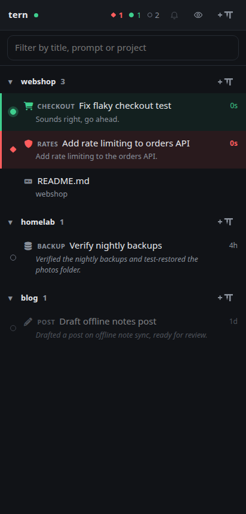
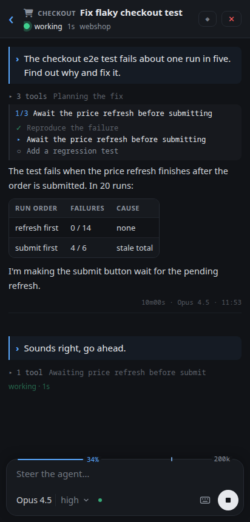
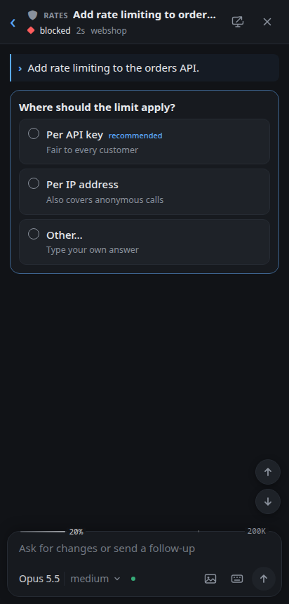
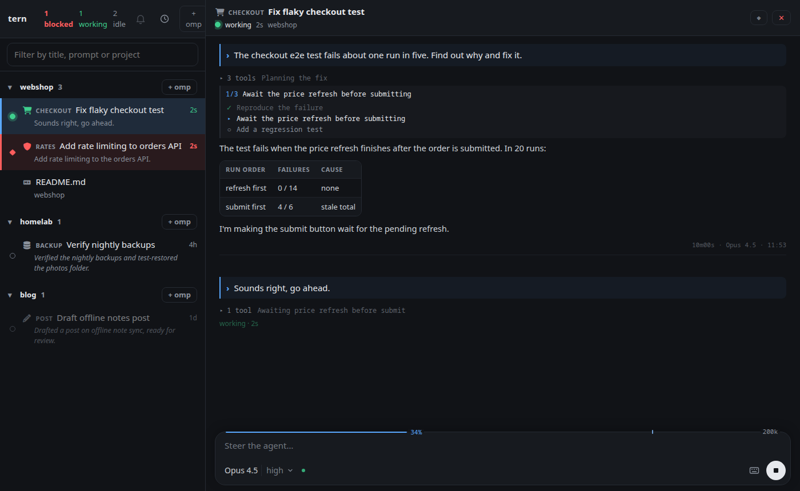

# tern-awui (another web UI for Tern)

A web app for following and steering the [omp](https://github.com/can1357/oh-my-pi) agents running in [Tern](https://stencil.so/tern), from a phone or another browser. It has no login of its own: you reach it over a private network you control, such as Tailscale (see [Security](#security)).

I built it for how I work. Tern stays open on the desktop with its panes, tern-awui sits next to it in a browser tab, and the same app is installed on my Android phone as a PWA. When I step away, I can still see which agent finished, which one is waiting for an answer, and reply. It's a companion to Tern, not a replacement, and a stopgap until Tern's official mobile client ships.

| Phone: sessions | Phone: a session | Phone: a question |
|---|---|---|
|  |  |  |



The screenshots show invented sessions; `bun docs/screenshots.ts` regenerates them.

## Features

- **Every omp session at a glance.** Working, waiting for you, or idle, with the time in that status, the session's title, icon and tag, and the last prompt or omp's own recap.
- **Grouped by project.** Sessions are grouped by git repository (or folder), the most recently active first. Projects fold away, and sessions untouched for a day can be hidden with one tap.
- **The conversation, not the terminal.** omp sessions show as a chat: prompts, Markdown answers, collapsed tool runs, todo lists, tables with bar charts, SVG and Mermaid figures, images and screenshots, advisor notes, injected omp rules, omp's idle recaps under the turns they sum up, and the reply streaming in as omp writes it. Replies written as stretchtext (`{{short|long}}`, by an omp stretchtext extension) open phrase by phrase with a tap, in step with the Tern pane.
- **Two-way control.** Send prompts, steer a running turn or queue a follow-up, stop the agent, answer `ask` questions by tapping an option, attach images from the camera or gallery (or paste them), and use omp's own `/command`, `/skill:` and `@file` completions.
- **The draft is shared.** Text typed on the phone appears in the Tern pane's prompt, and text typed on the desktop appears on the phone, so you can start on one and finish on the other.
- **Model and effort.** Switch the model, thinking effort and service tier, or pick one of your Ctrl+P roles. A gauge shows how full the context window is and where compaction will start.
- **Notifications.** Optional push notifications when a session finishes or needs you, and an unread count on the app icon.
- **Rewind and side questions.** Copy or rewind to an earlier prompt, ask a quick `/btw` question without touching the session, and browse the session's saved btw history with bare `/btw`.
- **Subagents.** See running subagents and background jobs, and read any subagent's conversation.
- **Shells and files too.** Plain terminals show their screen with a key bar (Esc, ^C, arrows, Tab), and Tern notes and opened files are readable.
- **Phone and desktop.** On a phone it is one column; in a desktop browser the session list stays in a sidebar next to the open session, or shrinks to a rail of status-colored session icons (Ctrl+\).

## How it differs from Tern

Tern is a full terminal multiplexer. tern-awui looks only at what I need away from the keyboard:

- **omp first.** An omp pane shows as a conversation instead of a terminal screen. Other panes are still there, but secondary.
- **No tabs or splits.** All panes are in one flat list, grouped by project, regardless of which Tern window or tab they live in.
- **Recent work in front.** The newest activity is on top, old sessions can be hidden, and idle sessions show what they did last.
- **Status and notifications.** It is built around "who needs me", with counts in the header, red for waiting, green for finished and unread markers.

It works with Tern rather than beside it:

- **Close** a session from the web, and its pane closes in Tern.
- **+ omp** opens a new omp tab in Tern in any project folder and jumps to it.
- **⌖** focuses that pane in the Tern window on the desktop.
- Drafts, model changes, answers and rewinds happen in the real omp session in its Tern pane, so the desktop and the web never disagree.

## Platforms

- **Linux** with Tern and Chrome on Android: what I use every day.
- **macOS**: install, the launchd service, `tailscale serve` and the omp extension tested on a MacBook (Apple Silicon, macOS 26).
- **iPhone (Safari) and Windows** should work. The installer has Windows support, but neither has been tested yet. Reports are welcome.

## Requirements

- [Bun](https://bun.sh) 1.4 or newer
- Tern, with the `tern` command on `PATH`
- omp, with the `omp` command on `PATH`
- [Tailscale](https://tailscale.com) (optional, but the installer needs it), logged in, with MagicDNS and HTTPS certificates enabled for the tailnet. Without it, see [Without Tailscale](#without-tailscale).
- git (optional, for grouping by repository and showing branches)

## Install

### With a coding agent

The easiest way is to let your coding agent (omp, Claude Code, Codex, …) do it. Paste this prompt into an agent running on the desktop where Tern runs:

```text
Install tern-awui (https://github.com/materemias/tern-awui) on this machine.

1. Read its README, especially Requirements, Install and Security.
2. Check every requirement and tell me what is missing instead of working around it.
   The installer needs Tailscale logged in with MagicDNS and HTTPS certificates enabled.
3. Clone it to ~/code/tern-awui (ask me if I want a different place), then run `bun install`.
4. Run `bun install.ts --dry-run`, summarize what it will write and run, and wait for my OK.
5. Run `bun install.ts` and give me the address it prints.

Never use Tailscale Funnel, port forwarding or a public tunnel.
At the end, remind me to run /restart in omp sessions that were already running.
```

### By hand

```bash
git clone https://github.com/materemias/tern-awui.git
cd tern-awui
bun install
bun install.ts            # add --dry-run to see every step first
```

The installer sets it up with Tailscale, in one go:

1. builds the web app;
2. installs the omp extension (see below);
3. creates a background service for your user (systemd on Linux, launchd on macOS, Task Scheduler on Windows) and starts it;
4. publishes it on your tailnet with `tailscale serve`;
5. prints the address, e.g. `https://my-desktop.tailnet-name.ts.net:4380/`.

Open that address on each device while signed in to Tailscale. On Android, use Chrome's ⋮ → *Add to Home screen* to install it as an app. On iPhone, use Safari's Share → *Add to Home Screen*. The installer turns on the login allowlist with your own Tailscale login (see [Security](#security)), so there is nothing to pair.

### Without Tailscale

The server runs on its own, on loopback only:

```bash
bun install && bun run build
bun server.ts                    # http://127.0.0.1:4380/, TERN_AWUI_PORT changes the port
```

Put the omp extension in place by hand (below). Starting the server at login, and reaching it from other devices, is up to you. Read [Security](#security) first: whatever you put in front of the port is the only thing protecting your terminals.

### The omp extension

Most features (status, chat, shared drafts, model picker, notifications) come from a small omp extension that connects each omp session to the server. The installer puts it in place. The best way, which the installer uses on Linux and macOS, is a **symlink** from omp's extension folder to the checkout:

```bash
ln -s "$PWD/omp-extension/tern-mobile.ts" ~/.omp/agent/extensions/tern-mobile.ts
```

That way a `git pull` updates the extension as well. On Windows the installer copies the file instead, so run `bun install.ts` again after updating.

omp loads extensions only when it starts, so **sessions that were already running need a restart**. In each one, run `/restart`: omp restarts in the same pane and continues the session. The web app marks sessions running an outdated extension and offers a **Reload** button that does this for you.

### Updating and removing

```bash
git pull && bun install.ts      # rebuild, update and restart the service
bun install.ts --uninstall      # remove the service, the extension and the tailnet entry
```

## Security

**tern-awui has no authentication.** Anyone who can send it a request controls your terminals: they can type commands, read your agents' conversations and open files. It doesn't pretend otherwise.

It listens on `127.0.0.1` only. Who reaches that port is decided by you and by what you put in front of it, not by tern-awui:

- **Loopback only** (no proxy): only programs on this machine reach it.
- **Tailscale Serve** (what the installer sets up): only devices on your tailnet reach it. Set `TERN_AWUI_ALLOW` (the installer does) to let in only your own Tailscale login rather than everyone on the tailnet.
- **Another authenticating proxy** (e.g. Cloudflare Tunnel with Cloudflare Access, an SSH tunnel): it must refuse everyone but you. Add the name it serves under to `TERN_AWUI_HOSTS`.

**Never expose it publicly:** no port forwarding, no Tailscale Funnel, no tunnel without its own login.

What it assumes:

- **A single-user machine.** Every local account can connect to `127.0.0.1` and so control your terminals. Nothing in tern-awui stops that.
- **`TERN_AWUI_ALLOW` is only as good as Tailscale Serve.** It checks the `Tailscale-User-Login` header, which Tailscale Serve sets and anything else can fake. Behind another proxy it is only trustworthy if the proxy overwrites that header itself.

What it does on its own is narrow: it stops websites open in your own browser from using it. A page can't post to it (a custom header is required), can't open its bridge (that needs a token from a file only your account can read), and can't rebind its own domain to 127.0.0.1 (requests naming any host but loopback and `TERN_AWUI_HOSTS` get 403). It also sends a Content-Security-Policy, so agent output can't load images from other sites.

Details are in [how it works](docs/architecture.md#security).

## Limits

- It is not a terminal emulator. Full-screen programs like vim or htop are only usable through the screen view and the key bar.
- Sessions without the extension show as plain terminals.
- Desktop Ctrl+Q follow-ups without a `->` prefix show as steers, because omp doesn't tell extensions which key sent a prompt.
- Answers to `/btw <question>` asked from the web aren't saved in omp's btw history.
- The extension uses some omp internals; a new omp version can turn individual features off until the extension catches up.

## Companion: CodexBar AgentView

[CodexBar AgentView](https://github.com/materemias/codexbar-agentview) is the desktop-side counterpart. Its native Tern extension puts AI provider usage and agent counts (working, blocked, idle) in Tern's status line, with a sidebar for usage, agents and session history, and it can restore your Tern sessions after a reboot. It also has a KDE Plasma widget. tern-awui doesn't need it: they share no code or data, and each works on its own.

## More

- [How it works](docs/architecture.md): every feature in detail, the extension's protocol, configuration, build and tests.
- [CHANGELOG](CHANGELOG.md)
- License: [MIT](LICENSE). The bundled Nerd Font symbols are SIL OFL 1.1 ([license](assets/LICENSE-nerd-fonts-symbols)).
